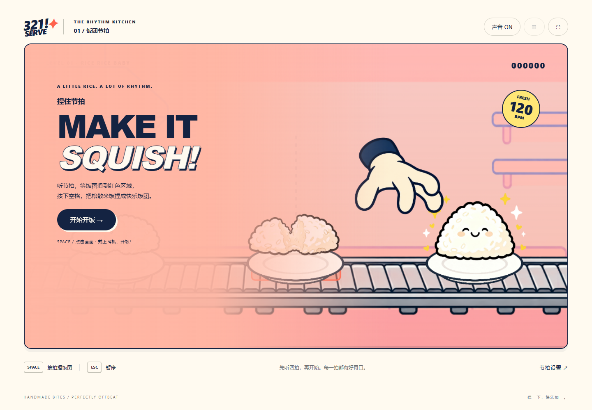

# 321 Serve

A music rhythm game.

## Play the first interaction prototype · 第一版交互原型

Download or clone this repository, then open **index.html** in a modern browser. No build step, network connection or runtime dependencies are needed. Keep the assets folder next to the HTML file. On phones, landscape orientation is recommended.

下载仓库后直接打开 **index.html**，无需安装依赖。建议使用桌面 Chrome / Edge，手机推荐横屏。

- Press **Space** or tap the game canvas as a rice plate reaches the central red zone.
- **Escape** pauses/resumes; the top bar also includes pause, mute and fullscreen controls.
- The yellow **SQUISH** section asks for one press every two beats.
- 120 BPM · 47 seconds · 56 notes · four-beat count-in.
- Perfect: ±75 ms. Good: ±155 ms. Late notes miss automatically; extra presses break the combo and reduce accuracy.
- Successful hits trigger squash, rice particles and impact sound. Wrong or missed hits display a large red anger symbol and an angry rice face.
- Optional input compensation: −200 to +200 ms. Positive values compensate late input. Reduced-motion mode removes shaking and the close-up camera change.

### Version scope

This is an interaction prototype, with a synthesized Web Audio rhythm track and a fixed chart. It is not a final music track or an engine build. Hardware/audio latency still needs real-device playtesting. The original UI references and design documents below are preserved.

### Verification

Browser checks cover asset loading, keyboard and pointer hits, off-beat feedback, pause/resume, the squish segment, results, restart, and a 375px viewport. To repeat: install Playwright as a development tool, install its Chromium browser, and run **node verify.cjs**. Optional environment variables PLAYWRIGHT_MODULE and BROWSER_PATH select an existing local installation.

This repository holds the visual design and development materials for *321 Serve*.

---

## Visual Design

The full visual design of the game — interface layouts, visual style, and component guidelines — is created in Figma:

**Figma design → [HP – 321 Serve](https://www.figma.com/design/wDOcRmw9hqUAvnOOdLzmeV/HP?node-id=0-1&p=f)**

> The Figma file above is our team's original visual design for the game. It defines the interface and visual direction of the project, and all subsequent development follows it as the reference.

---

## Project Info

| Item | Details |
| --- | --- |
| Title | 321 Serve |
| Genre | Music rhythm game |
| Visual design | [Figma](https://www.figma.com/design/wDOcRmw9hqUAvnOOdLzmeV/HP?node-id=0-1&p=f) |
| Stage | v0.1 — first playable interaction prototype |

---

## Structure

| Path | Contents |
| --- | --- |
| [Complete UI / 完整界面](assets/ui/complete/) | Full screen layout references and complete dialog panels |
| [Separate UI elements / 独立元素](assets/ui/elements/) | Transparent components for game integration |
| [UI backgrounds / 背景](assets/ui/backgrounds/) | Kitchen background images |
| [UI asset guide](assets/ui/README.md) | Folder usage, duplicate cleanup and component notes |
| [assets/game/](assets/game/) | Game asset overview |
| [docs/Sushi_Rhythm_Design_and_Assets.docx](docs/Sushi_Rhythm_Design_and_Assets.docx) | Chinese transcription of the handwritten game design and asset list, dated 2 November 2026 |

Full screen references and the game asset overview are preserved as supplied. UI components are separated into a dedicated elements directory; see the UI asset guide before implementation. The Chinese design document records an earlier proposal and its open questions; it is not a statement that every listed feature or asset is complete.

---

## Contact

For design or development questions, please reach the team through the repository issues.

