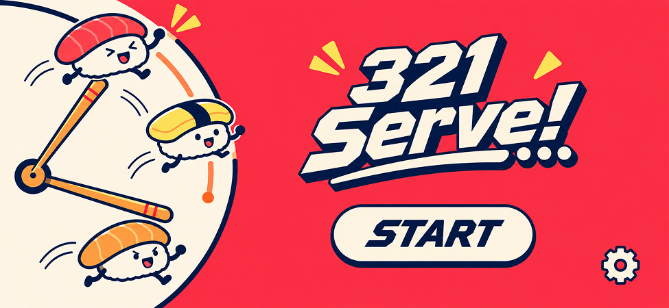

# 321 Serve

A rhythm game about shaping rice balls to the beat.

一款跟着节拍捏饭团的音乐游戏。

## Play locally · 本地试玩

Download or clone this repository, then open **index.html** in a modern browser. No build step, network connection or runtime dependencies are needed. Keep the assets folder next to the HTML file. On phones, landscape orientation is recommended.

下载仓库后，用 Chrome 或 Edge 打开 [index.html](index.html)，点击 **START**，阅读教学后点击 **GOT IT**。无需安装依赖，手机试玩推荐横屏。

- Click **START**, then **GOT IT**. A static **3 → 2 → 1 → GO!** plays before the unchanged soundtrack starts from zero; then listen for its original four-beat lead-in. Press **Space** or tap the game canvas as a rice plate reaches the central red zone.
- **Escape** pauses/resumes; use the upper-right pause button or the SOUND / FULLSCREEN controls beneath the game.
- The yellow **SQUISH** section asks for one press every two beats.
- 120 BPM · 47 seconds · 56 notes · four-beat count-in.
- Perfect: ±75 ms. Good: ±155 ms. Late notes miss automatically; extra presses break the combo and reduce accuracy.
- Open the gear on the start screen to adjust input compensation from −200 to +200 ms. Positive values compensate late input. Reduced-motion mode removes shaking and the close-up camera change.

### v0.1 UI update · 界面更新

- The start screen uses the repository artwork for the sushi turntable, logo, START button and settings gear. The count-in uses the illustrated **3 → 2 → 1** assets followed by **GO!**.
- Both normal play and SQUISH show **ON BEAT!** for Perfect and Good hits, with the judgment and timing offset beneath the artwork. **MISS!** shows **TOO LATE** for a missed note or **OFF BEAT** for an extra press.

开场使用仓库里的寿司转盘、Logo 和按钮素材。普通段和 SQUISH 段共用判定贴图。命中时显示 **ON BEAT!** 和偏差毫秒数，漏拍或误触时显示 **MISS!** 和具体原因。

### Version scope

The browser prototype plays a bundled soundtrack from [assets/audio](assets/audio/) and uses its playback time to synchronize the fixed chart. Hit and miss effects are synthesized with Web Audio. Audio and input latency still need real-device playtesting.

### UI integration · 16 November 2026

The start screen, tutorial, countdown, judgment feedback, pause, settings, quit confirmation and results use the supplied UI components. Large headings remain supplied artwork; small runtime text is English in locally bundled IBM Plex Mono. Results display the actual calculated percentage.

The six-note HUD records chart judgments: coral circle = Perfect/Good, cross = missed note, cream = pending. It advances through groups of six using the existing music playback clock and input-offset setting. An extra off-beat press still shows MISS feedback and affects the original score; it does not consume a scheduled note. Dots keep a square aspect ratio and are independent of camera shake.

Canvas resolution follows the displayed size and device pixel ratio (up to 3×); pause and percentage artwork use SVG. Source PNGs are preserved rather than artificially upscaled, so low-resolution source backgrounds can still look soft on large screens. The soundtrack, chart, judgment windows and sound-effect synthesis are unchanged; volume sliders default to the previous levels.

### Verification

Run `node tests/ui-regression.cjs` for dependency-free HUD, percentage and asset checks. An optional native Canvas integration check is documented in [verification notes](docs/prototype/VERIFICATION.md). For browser checks, install Playwright and Chromium, then run `node verify.cjs`; `PLAYWRIGHT_MODULE` and `BROWSER_PATH` can select an existing installation. The latest UI passed Node and native Canvas integration checks; browser/device visual and audio-latency checks remain to be run on a machine with browser access.

### Font credit

IBM Plex Mono © IBM Corp., licensed under the SIL Open Font License 1.1. The font and [license](assets/fonts/IBM-Plex-Mono-OFL.txt) are bundled locally. AI assistance was used for UI integration, responsive styling and regression checks; the supplied design artwork remains the visual reference.

This repository holds the visual design and development materials for *321 Serve*.

---

## Visual Design

The full visual design of the game — interface layouts, visual style, and component guidelines — is created in Figma:

**Figma design → [HP – 321 Serve](https://www.figma.com/design/wDOcRmw9hqUAvnOOdLzmeV/HP?node-id=0-1&p=f)**

> The Figma file above is our team's original visual design for the game. It defines the interface and visual direction of the project, and all subsequent development follows it as the reference.

---

## UI Design Evolution · UI 设计演进

The milestones below describe the **UI design process**. The existing v0.1 UI integration notes and playable-prototype version remain part of the project history.

以下版本记录 **UI 设计的演进过程**；原有的 v0.1 界面接入记录和可玩原型版本说明继续保留。

### v0.0 — Startpage exploration and direction selection · 开始页探索与方向确定

- Explored **six Startpage proposals** and selected the start-screen design currently used in the project.
- Used the selected Startpage to establish the game's visual direction and large-heading lettering. The initial **rounded, soft, playful lettering** evolved into the current **forward-slanted, angular, heavy display lettering with a thick dark-navy outline and cream fill**. The sharper corners, cut edges and strong contrast give the title a more energetic, rhythmic, arcade-like character.

- 探索了 **6 个 Startpage 方案**，从中选定目前项目使用的开始页设计。
- 通过选定的 Startpage 确定整体视觉方向与大标题字形：从最初 **偏圆润、柔和、可爱** 的字体，调整为现在 **向前倾斜、棱角分明、带切角结构的粗重展示字形**，搭配 **厚深蓝描边与米白色字面**，加强速度感、节奏感和街机游戏的视觉辨识度。

### v0.2 — Complete UI design system · 全套 UI 设计完善

- Extended the visual language established by the selected Startpage into the **full UI design set**: start screen, tutorial, 3–2–1–GO! countdown, gameplay HUD, ON BEAT!/MISS! feedback, pause, settings, quit confirmation and results.
- Defined a consistent treatment for large-heading artwork, IBM Plex Mono small text, cream/navy/coral colors, thick outlines, buttons, icons, feedback components and screen layouts.
- Refined the individual UI assets and their use across screens, including the score percentage artwork, to keep the interface visually consistent.

- 以选定的 Startpage 和确定后的标题风格为基础，制定并完善 **全套 UI**：开始页、教学页、3–2–1–GO! 倒计时、游戏 HUD、ON BEAT!/MISS! 判定反馈、暂停、设置、退出确认及结算页。
- 统一大标题图形字、IBM Plex Mono 英文小字、米白／深蓝／珊瑚红配色、厚描边、按钮、图标、反馈组件与各页面排版规则。
- 逐步完善独立 UI 元素及跨页面的使用方式，包括结算百分比素材，使各界面遵循同一套视觉语言。

See the [complete UI references](assets/ui/complete/), [individual UI elements](assets/ui/elements/) and [UI asset guide](assets/ui/README.md) for the design assets and integration guidance.

完整设计与独立素材参见 [完整 UI 参考](assets/ui/complete/)、[独立 UI 元素](assets/ui/elements/)及 [UI 素材说明](assets/ui/README.md)。

---

## Project Info

| Item | Details |
| --- | --- |
| Title | 321 Serve |
| Genre | Music rhythm game |
| Visual design | [Figma](https://www.figma.com/design/wDOcRmw9hqUAvnOOdLzmeV/HP?node-id=0-1&p=f) |
| Stage | v0.1 — first playable interaction prototype |

---

## Structure

| Path | Contents |
| --- | --- |
| [Complete UI / 完整界面](assets/ui/complete/) | Full screen layout references and complete dialog panels |
| [Separate UI elements / 独立元素](assets/ui/elements/) | Transparent components for game integration |
| [UI backgrounds / 背景](assets/ui/backgrounds/) | Kitchen background images |
| [UI asset guide](assets/ui/README.md) | Folder usage, duplicate cleanup and component notes |
| [assets/game/](assets/game/) | Game asset overview |
| [docs/Sushi_Rhythm_Design_and_Assets.docx](docs/Sushi_Rhythm_Design_and_Assets.docx) | Chinese transcription of the handwritten game design and asset list, dated 2 November 2026 |

Full screen references and the game asset overview are preserved as supplied. UI components are separated into a dedicated elements directory; see the UI asset guide before implementation. The Chinese design document records an earlier proposal and its open questions; it is not a statement that every listed feature or asset is complete.

---

## Contact

For design or development questions, please reach the team through the repository issues.
