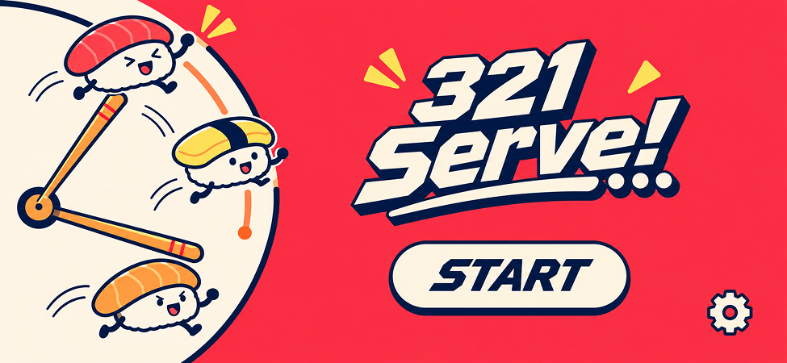

# 旧版 README 存档

> 保留历次原始说明。当前试玩、玩法和开发入口见[项目首页](../../README.md)。

## 交互音效更新

正式关卡恢复纯音乐底轨。完整原始音频保留，交互用的动作段保存于 `assets/audio/rice-20261124/interactive/`，`segments.json` 记录每段在原整块音频中的入点、出点。保持现有组起点和组内动作时间，机器／弹出／反弹预备声自动播放，捏与拍只由实际操作触发；教学示范由自动示范动作触发。三连三次捏分别使用原音频中的三段捏声，末尾 D 补回拍走音。

教学使用整首纯音乐循环，同一项示范、练习、失败重试保留音乐进度，新一项教学与正式关卡从零开始。下方原音固定播放说明已被此更新替代。

## 原音播放更新

正式关卡完整播放用户提供的 `rice总体音乐合成版.mp3`，不剪切、不变速、不重排，不叠加按键音效。教学完整播放对应的“弹出+捏+拍”等打包音频。音频内嵌数据与保留的原始 MP3 字节相同。合成版锁定从零播放，旧调音偏移不应用到这一模式。画面和判定沿用匹配得到的时间表；打包片段内部动画节点是估计位置，并非作者提供的逐动作标记。

合成版中预录的海绵误捏音也原样播放，游戏仍保持 D 正确、A 错误的规则。下方早期拆分播放说明已被此更新替代。

## 音乐同步关卡 · 2026-11-24

当前音乐来自 `assets/audio/rice-20261124/`，合成参考约 76.852 秒，通过素材相关性匹配定位 44 组事件、90 个操作点。`timing.json` 保存每组起始时间及匹配置信度，`game.js` 的 `phraseSeconds` 保存组内动作时间。保持 140 BPM 的编辑刻度，实际事件按秒定位，不强制吸附到旧拍表。

播放使用提供的纯音乐与拆分预备音；捏、拍声音随输入触发，避免合成参考里的预录操作声重复播放。A 误捏海绵、D 正确拍走海绵分别使用不同素材。三连素材的三个捏点由普通捏声匹配定位，末尾补一次扫走，保留三捏一扫规则。视觉蓄力、逐份弹出、反弹和操作判定使用同一时间表，时钟来自 AudioContext。

新音乐使用独立浏览器存储命名空间，旧草稿未删除。直接打开 index.html 即可，内嵌音频用于兼容 file://，原始及拆分 MP3 同时保留以便后续调整。浏览器验证：`tests/rice-score.cjs`、`tests/tutorial-audio.cjs`。

以下为旧版本记录，旧的关卡时长与分组数以本节为准。

# 当前 HTML 试玩版 · 2026-11-19

打开 index.html，点击 START，先完成四项教学：正常出饭、故障连出、故障反弹和海绵。每项先自动示范一遍，再让玩家按相同节奏练习；全部动作在提示音前后 0.4 拍内完成才通过，否则重练当前项。四项通过后自动进入正式关卡。A 捏饭，D 圆弧下扫，触屏左侧捏、右侧扫。节奏为 140 BPM，相邻动作之间留一整拍，正式关卡 30 组约 1 分 24 秒。三连饭半拍内逐份弹出，按右、中、左顺序捏三份，再用 D 扫走。海绵只能用 D 拍走；A 捏海绵会触发错误的溅水分支。

包含与游戏时钟同步的合成背景配乐和操作点提示音。每类饭团有不同预备音：正常机器运转；故障连出为机器运转、红灯和冒烟；反弹为卡顿运转、红灯和特殊弹出；海绵为挤压与特殊运转，并在弹出时发出“吧唧”声。右上声音按钮统一静音，Esc 暂停或继续。圆环收拢时，听到 A/D 对应的短音即可出手。

素材在 assets/level1，配乐与音效实现于 soundtrack.js。Godot 可编辑原型在 godot/project.godot，其进度对应此前移植版本。以下保留开发历史，当前 HTML 操作与节奏以本节为准。

## 调音台 · 音频剪辑工作台

右上角点击“调音台 ♫”。保留游戏的 140 BPM 和原有操作判定，独立编辑声音。

- **导入**：把多个音频拖到导入区，或点“添加独立音效”，在当前播放头位置建立音效。拖到某条轨道或点“换”会替换该音源。背景音乐按原速循环，不会自动匹配导入歌曲的 BPM。
- **波形**：内置声音、导入音频以及组合音效均显示真实波形。内置音效可点 ↓ 导出为 WAV。选中导入音频可查看放大的原始波形和保留范围。
- **裁剪与移动**：拖片段两端裁剪，拖中间移动。方向键每次移动 0.001 拍，Shift 加方向键移动 0.01 拍。Alt / Option 拖动临时关闭吸附；也可直接填写位置、入点和出点。裁剪不破坏原文件，可恢复原长度。同一游戏音源的裁剪会作用于它的重复触发片段，轨道上的说明会提示这一点。
- **时间线**：主时间线和子草稿都有 1/4 与 1/3 拍刻度。可选择吸附、自由移动和 50%–400% 缩放，缩放不改变音乐时间。拖进度条或时间尺定位。空格播放／暂停当前时间线；子草稿打开时可在其中预览组合。
- **子草稿**：双击片段或点轨道的“层”，查看组合波形、原声和各个子音效。子音效可分别裁剪、移动、调音量、删除。组合波形按实际混音生成，组合本身也可以裁剪。
- **删除与撤销**：选中后 Delete / Backspace，或点删除按钮。轨道 × 删除整条音源，包括背景音乐。支持最多 50 步撤销／重做，按钮和 ⌘ / Ctrl + Z、⌘ / Ctrl + Shift + Z 均可用。恢复已删除音效可恢复被删除的轨道和触发片段。
- **保存与草稿**：点击“保存”或 ⌘ / Ctrl + S，把音频文件、裁剪、位置、组合和音量一起存到当前浏览器。下次打开以最后保存的版本建立可编辑草稿。“新草稿”放弃未保存编辑并从最后保存版本开始，有未保存内容时会先确认。保存覆盖当前保存版本，撤销历史只保留在当前页面。导出工程可把音频一起备份成 JSON，换浏览器或设备时再导入并保存。

● 固定音效按时间线播放。◆ 按键响应声在游戏按键后触发，移动它改变响应延迟，不会改变游戏的操作判定。编辑器预览会模拟正确按键，游戏中实际声音随玩家操作触发。

浏览器验证：`PLAYWRIGHT_MODULE=<playwright模块路径> BROWSER_PATH=<Chromium路径> node tests/audio-studio.cjs` 和 `node tests/tutorial-audio.cjs`。

## 动势与操作更新

A 捏饭，D 从上向下扫走，触屏左侧捏、右侧下扫。手仅由按键或触屏触发，漏拍不自动伸手。出饭采用蓄力压缩、突然释放、减速落地，捏饭快速伸入再回收，下扫加速并带走饭团。

前十一句采用 11122332211，1 为单份、2 为蓄力弹饭、3 为三连饭；随后加入海绵、三连和单份收尾。三连输入 A、A、A、D。图层按桌面、饭团、机器出口、手、水滴顺序绘制，动作裁剪在操作台内。

## 新版关卡 · 2026-11-19

打开 index.html，点击 START。A 捏饭，D 手刀拍走，Space 兼容捏饭。触屏左半边捏饭、右半边手刀。右下圆环收拢到内圈时按键。

47 秒关卡依次包含正常出饭、故障弹饭、三连饭、海绵和混合挑战。正常出饭轻抖，故障在出饭前红灯、抖动、黑烟与蓄力。三连饭按 A、A、A、D，最后一次手刀扫走整批。

海绵直接 D 扫走，误按 A 会溅水并断连击。这是依据分镜两条动作分支采用的规则假设。具体节拍由本版安排，沿用原背景音乐，需要实机试听校准。

素材来自 Figma 页面 303:2 的 Assets 与逐帧分镜，保存在 assets/level1。画面用独立图层实时绘制。Perfect 显示成形饭团，Good 显示不规则饭团，漏捏保留散饭。

下方是旧版记录，旧版的空格单键与黄色特写说明已由上述新版操作替代。

# 321 Serve

A rhythm game about shaping rice balls to the beat.

一款跟着节拍捏饭团的音乐游戏。

## Play locally · 本地试玩

Download or clone this repository, then open **index.html** in a modern browser. No build step, network connection or runtime dependencies are needed. Keep the assets folder next to the HTML file. On phones, landscape orientation is recommended.

下载仓库后，用 Chrome 或 Edge 打开 [index.html](../../index.html)，点击 **START**，阅读教学后点击 **GOT IT**。无需安装依赖，手机试玩推荐横屏。

- Click **START**, then **GOT IT**. A static **3 → 2 → 1 → GO!** plays before the unchanged soundtrack starts from zero; then listen for its original four-beat lead-in. Press **Space** or tap the game canvas as a rice plate reaches the central red zone.
- **Escape** pauses/resumes; use the upper-right pause button or the SOUND / FULLSCREEN controls beneath the game.
- The yellow **SQUISH** section asks for one press every two beats.
- 120 BPM · 47 seconds · 56 notes · four-beat count-in.
- Perfect: ±75 ms. Good: ±155 ms. Late notes miss automatically; extra presses break the combo and reduce accuracy.
- Open the gear on the start screen to adjust input compensation from −200 to +200 ms. Positive values compensate late input. Reduced-motion mode removes shaking and the close-up camera change.

### Playtest record · 试玩记录

[Playtest observations, next actions and owners · 试玩观察、后续计划与负责人](../../docs/playtest-log.md)

### v0.0 UI update · 界面更新

5 November 2026 · 2026年11月5日

- Explored **six Startpage designs** and selected the start-screen direction currently used in the project.
- Finalized the large-heading style based on the selected Startpage: the initial rounded, soft lettering became **forward-slanted, angular, heavy display lettering with cut corners, a thick dark-navy outline and cream fill**, giving the interface a stronger sense of rhythm and arcade energy. Typography finalized: 9 November 2026 · 字体确定：2026年11月9日

11月5日从 **6 个 Startpage 方案**中选定目前使用的开始页方向；11月9日通过开始页确定大标题字形，由最初偏圆润、柔和的字体，调整为现在 **向前倾斜、棱角分明、带切角的粗重字形**，搭配厚深蓝描边与米白色字面，强化节奏感与街机游戏风格。

### v0.1 UI update · 界面更新

- The start screen uses the repository artwork for the sushi turntable, logo, START button and settings gear. The count-in uses the illustrated **3 → 2 → 1** assets followed by **GO!**.
- Both normal play and SQUISH show **ON BEAT!** for Perfect and Good hits, with the judgment and timing offset beneath the artwork. **MISS!** shows **TOO LATE** for a missed note or **OFF BEAT** for an extra press.

开场使用仓库里的寿司转盘、Logo 和按钮素材。普通段和 SQUISH 段共用判定贴图。命中时显示 **ON BEAT!** 和偏差毫秒数，漏拍或误触时显示 **MISS!** 和具体原因。

### v0.2 UI update · 界面更新

12 November 2026 · 2026年11月12日

- Extended the selected Startpage and confirmed heading style into the **complete UI set**: start screen, tutorial, **3 → 2 → 1 → GO!**, gameplay HUD, **ON BEAT!/MISS!**, pause, settings, quit confirmation and results.
- Updated the individual UI components and established consistent typography, colors, thick outlines, buttons, icons and screen layouts across the interface.

以选定的 Startpage 和确定后的标题风格为基础，制定并完善全部 UI 页面与小组件，覆盖开始页、教学、倒计时、游戏 HUD、判定反馈、暂停、设置、退出确认及结算页，并统一字体、配色、厚描边、按钮、图标和页面排版。

### Version scope

The browser prototype plays a bundled soundtrack from [assets/audio](../../assets/audio/) and uses its playback time to synchronize the fixed chart. Hit and miss effects are synthesized with Web Audio. Audio and input latency still need real-device playtesting.

### UI integration · 16 November 2026

The start screen, tutorial, countdown, judgment feedback, pause, settings, quit confirmation and results use the supplied UI components. Large headings remain supplied artwork; small runtime text is English in locally bundled IBM Plex Mono. Results display the actual calculated percentage.

The six-note HUD records chart judgments: coral circle = Perfect/Good, cross = missed note, cream = pending. It advances through groups of six using the existing music playback clock and input-offset setting. An extra off-beat press still shows MISS feedback and affects the original score; it does not consume a scheduled note. Dots keep a square aspect ratio and are independent of camera shake.

Canvas resolution follows the displayed size and device pixel ratio (up to 3×); pause and percentage artwork use SVG. Source PNGs are preserved rather than artificially upscaled, so low-resolution source backgrounds can still look soft on large screens. The soundtrack, chart, judgment windows and sound-effect synthesis are unchanged; volume sliders default to the previous levels.

### Verification

Run `node tests/ui-regression.cjs` for dependency-free HUD, percentage and asset checks. An optional native Canvas integration check is documented in [verification notes](../../docs/prototype/VERIFICATION.md). For browser checks, install Playwright and Chromium, then run `node verify.cjs`; `PLAYWRIGHT_MODULE` and `BROWSER_PATH` can select an existing installation. The latest UI passed Node and native Canvas integration checks; browser/device visual and audio-latency checks remain to be run on a machine with browser access.

### Font credit

IBM Plex Mono © IBM Corp., licensed under the SIL Open Font License 1.1. The font and [license](../../assets/fonts/IBM-Plex-Mono-OFL.txt) are bundled locally. AI assistance was used for UI integration, responsive styling and regression checks; the supplied design artwork remains the visual reference.

This repository holds the visual design and development materials for *321 Serve*.

---

## Visual Design

The full visual design of the game — interface layouts, visual style, and component guidelines — is created in Figma:

**Figma design → [HP – 321 Serve](https://www.figma.com/design/wDOcRmw9hqUAvnOOdLzmeV/HP?node-id=0-1&p=f)**

> The Figma file above is our team's original visual design for the game. It defines the interface and visual direction of the project, and all subsequent development follows it as the reference.

---

## Project Info

| Item | Details |
| --- | --- |
| Title | 321 Serve |
| Genre | Music rhythm game |
| Visual design | [Figma](https://www.figma.com/design/wDOcRmw9hqUAvnOOdLzmeV/HP?node-id=0-1&p=f) |
| Stage | v0.1 — first playable interaction prototype |

---

## Structure

| Path | Contents |
| --- | --- |
| [Complete UI / 完整界面](../../assets/ui/complete/) | Full screen layout references and complete dialog panels |
| [Separate UI elements / 独立元素](../../assets/ui/elements/) | Transparent components for game integration |
| [UI backgrounds / 背景](../../assets/ui/backgrounds/) | Kitchen background images |
| [UI asset guide](../../assets/ui/README.md) | Folder usage, duplicate cleanup and component notes |
| [assets/game/](../../assets/game/) | Game asset overview |
| [docs/Sushi_Rhythm_Design_and_Assets.docx](../../docs/Sushi_Rhythm_Design_and_Assets.docx) | Chinese transcription of the handwritten game design and asset list, dated 2 November 2026 |
| [docs/level-design-rhythm-plating.md](../../docs/level-design-rhythm-plating.md) | Level design for the rhythm plating stage: mechanics, rules and the full required art asset list (English) |

Full screen references and the game asset overview are preserved as supplied. UI components are separated into a dedicated elements directory; see the UI asset guide before implementation. The Chinese design document records an earlier proposal and its open questions; it is not a statement that every listed feature or asset is complete.

---

## Contact

For design or development questions, please reach the team through the repository issues.
